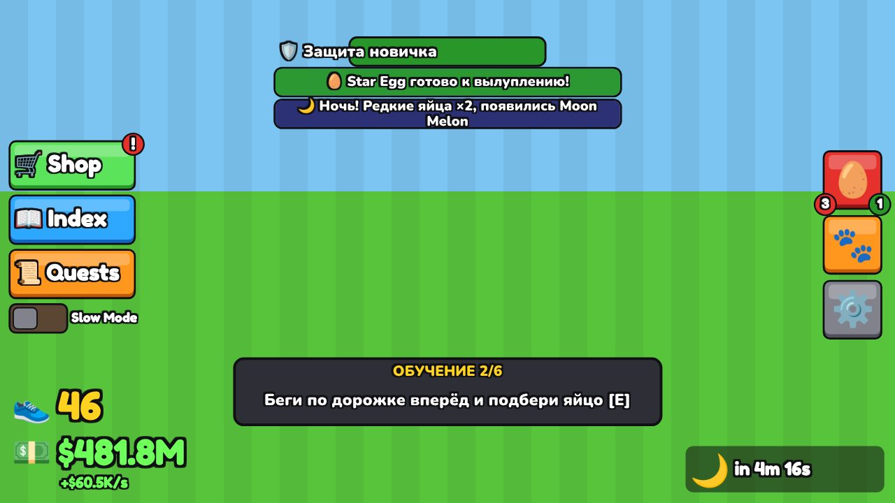
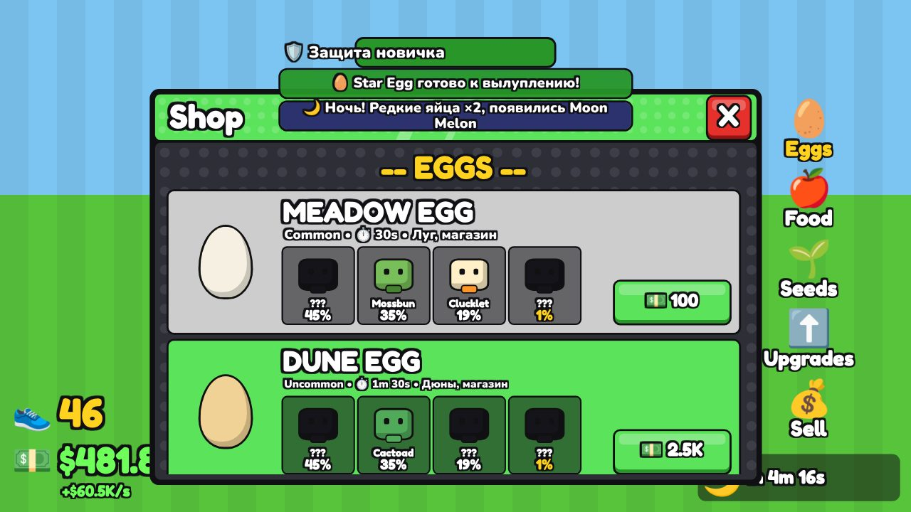
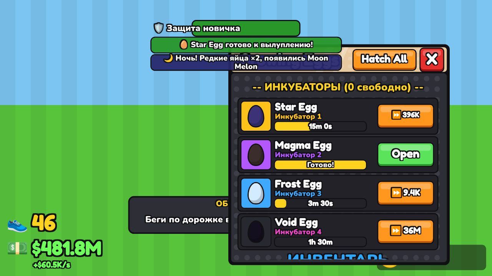
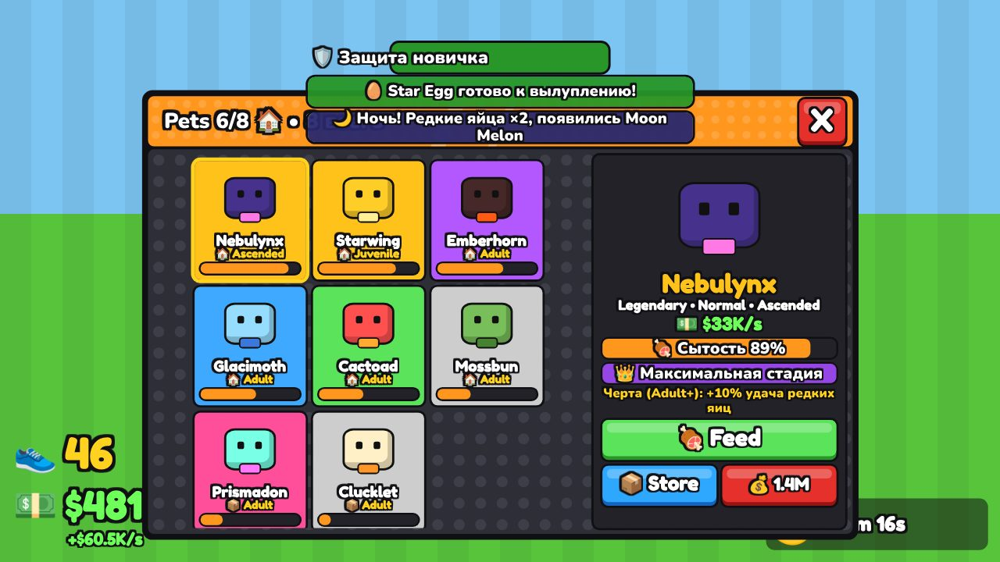

# Steal and Grow an Egg

Roblox-игра в студ-стиле: бегай по дорожке из пяти биомов за яйцами, кради их у других игроков,
высиживай, **выращивай** существ кормлением и фермой, развивай базу. Код синхронизируется в Studio через [Rojo](https://rojo.space).

| HUD | Магазин | Инкубаторы | Питомцы |
|---|---|---|---|
|  |  |  |  |

*Превью отрисованы из настоящего дерева GUI игры в эмуляторе (3D-модели заменены значками).*

## Документация

- [Исследование оригинала](docs/RESEARCH.md) — источники, подтверждённые механики, решения
- [Game Design Document](docs/GDD.md) — анализ референсов, UI-спецификация, яйца, рост, кража, экономика, карта
- [Архитектура](docs/ARCHITECTURE.md) — модули, сеть, сохранение, безопасность
- [Тестирование](docs/TESTING.md) — что проверено и что проверить в Studio

## Подключение к Studio (без терминала, Windows)

Один раз:

1. **GitHub Desktop** → File → Clone repository → `dylloxtt-source/Steal-and-grow-an-egg`.
2. Скачай `rojo-...-windows-x86_64.zip` с https://github.com/rojo-rbx/rojo/releases
   и положи `rojo.exe` в папку проекта (рядом с `start-rojo.bat`).
3. В Studio установи плагин **Rojo** из Creator Store (Toolbox → Plugins).
4. В Studio: **Game Settings → Security → Enable Studio Access to API Services** (для сохранений)
   и **Game Settings → Places/Players → Max Players = 6** (на карте 6 баз).

Каждый раз:

1. GitHub Desktop → **Fetch origin** → **Pull origin**.
2. Двойной клик по `start-rojo.bat` (окно не закрывать).
3. Studio → пустой Baseplate → **Plugins → Rojo → Connect** → **Play**.

Карта строится скриптом при запуске (Play), поэтому в режиме редактирования мир пустой — это нормально.

## Управление

| Действие | ПК | Телефон |
|---|---|---|
| Подобрать / открыть | E | тап по подсказке |
| Украсть яйцо из инкубатора | удерживать F | удерживать подсказку |
| Удар битой | клик с битой в руке (1) | тап |
| Забрать доход | встать на золотую кассу | так же |

## Структура

| Папка | Куда попадает |
|---|---|
| `src/shared` | `ReplicatedStorage.Shared` — конфиги баланса, логика, модели |
| `src/server` | `ServerScriptService.Server` — сервисы сервера |
| `src/client` | `StarterPlayerScripts.Client` — интерфейс и эффекты |

Баланс правится в `src/shared/Config/*.luau`.

## Проверки (для разработчика, нужен [Lune](https://lune-org.github.io/docs))

```
lune run tests/run.luau           # 414 юнит-тестов логики и конфигов
lune run tests/integration.luau   # 144 проверки сервера+клиента на эмуляторе движка
lune run tools/balance.luau       # таблицы баланса из конфигов
```
