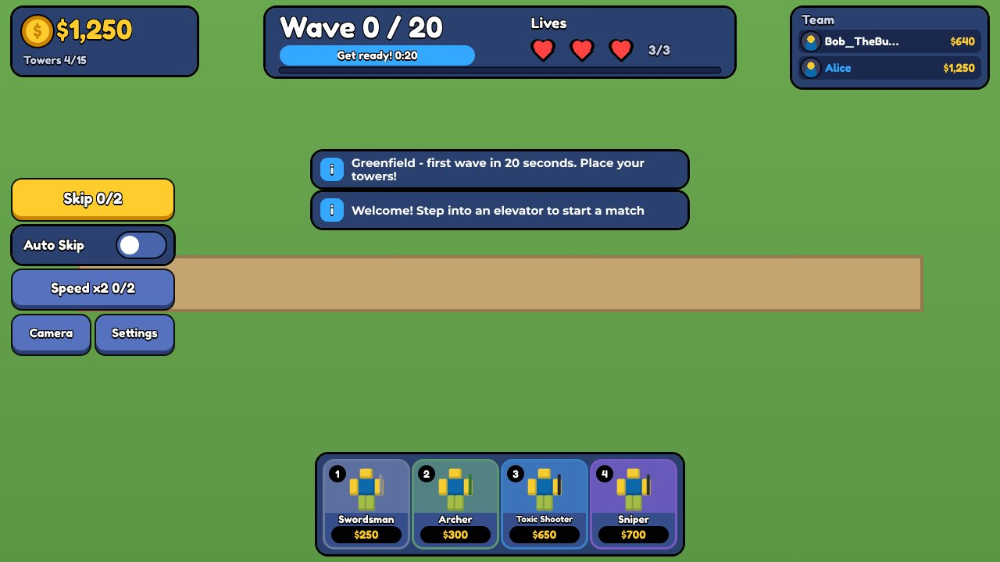
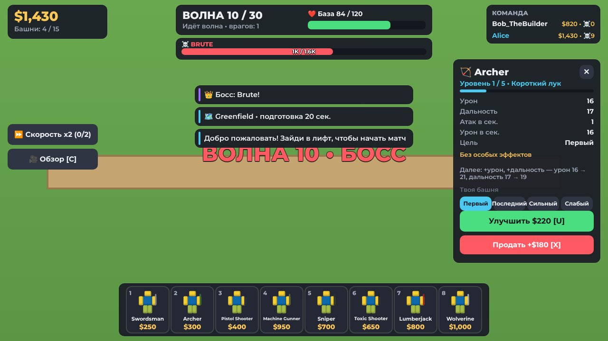
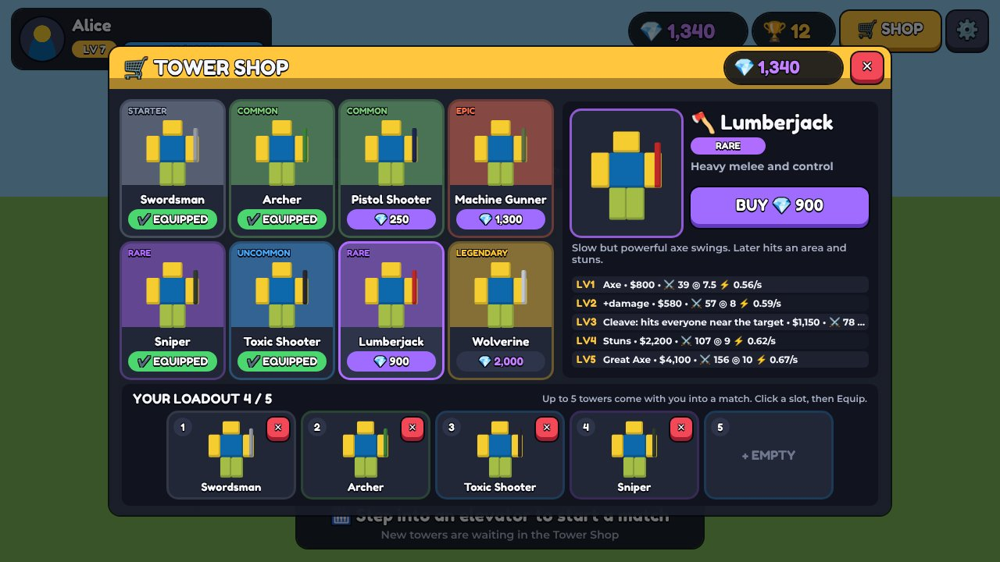
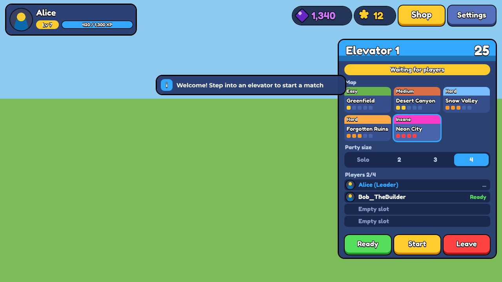
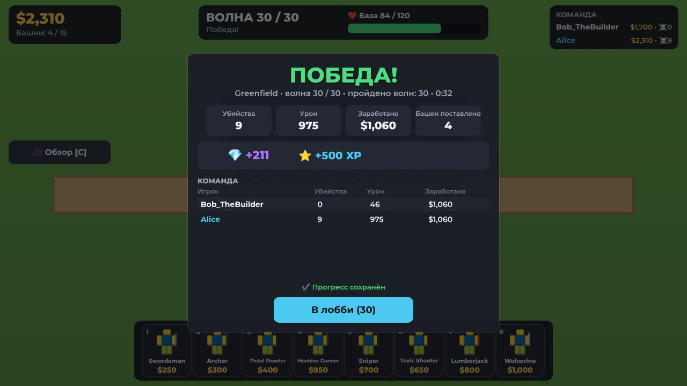
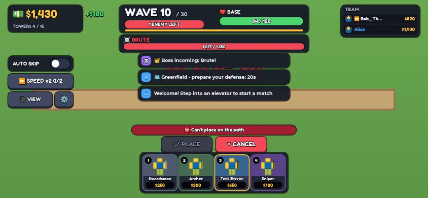
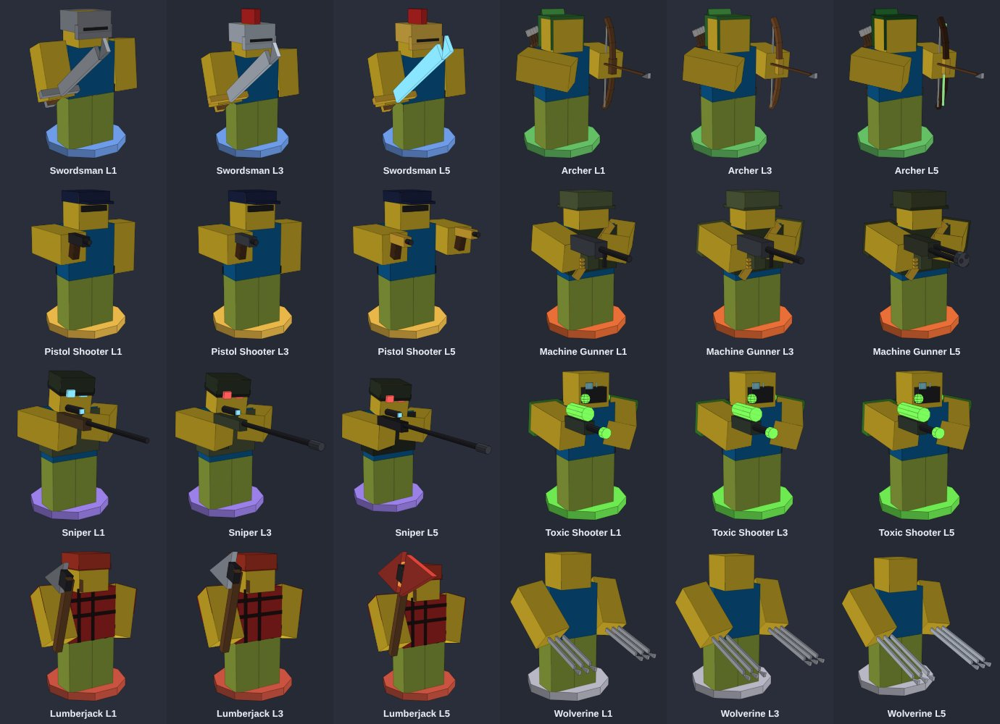
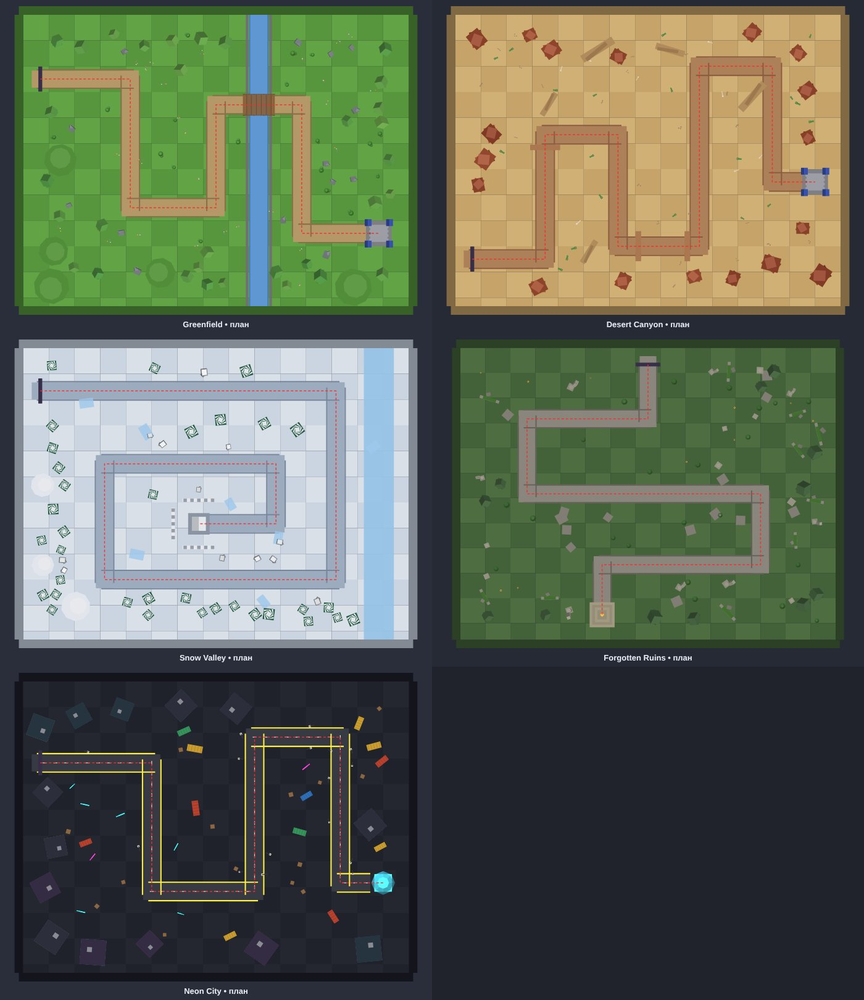

# R6 Tower Defense

Кооперативная Tower Defense для Roblox (весь текст игры — на английском): лобби с четырьмя лифтами,
группы до 4 игроков, 5 карт, 8 башен, 12 видов противников, магазин башен за гемы, набор из 5 башен
на матч, авто-скип волн. 20 волн, у базы 3 жизни. Карты и лобби — в классическом студ-стиле Roblox.
Все башни и враги — классические R6-персонажи (блочная голова, торс, руки и ноги).
Код синхронизируется в Studio через [Rojo](https://rojo.space).

| Матч | Окно башни | Магазин башен |
|---|---|---|
|  |  |  |
| **Лифт** | **Итоги** | **Телефон: размещение** |
|  |  |  |

*Превью нарисованы из настоящего дерева GUI игры в эмуляторе. 3D-модели в иконках заменены
схематичным R6-силуэтом, мир — условным фоном. Как интерфейс выглядит в Roblox, нужно проверить в Studio.*

## Подключение к Studio (без терминала, Windows)

Один раз:

1. **GitHub Desktop** → File → Clone repository → `dylloxtt-source/Steal-and-grow-an-egg`.
2. Скачай `rojo-...-windows-x86_64.zip` с https://github.com/rojo-rbx/rojo/releases
   и положи `rojo.exe` в папку проекта (рядом с `start-rojo.bat`).
3. В Studio установи плагин **Rojo** из Creator Store (Toolbox → Plugins).
4. Опубликуй место (File → Publish to Roblox) и включи
   **Game Settings → Security → Enable Studio Access to API Services** — без этого прогресс
   (гемы, уровень) в Studio не сохраняется, и игра честно пишет «Тестовый режим: прогресс не сохраняется».
5. **Game Settings → Places → Max Players**: 12–16 (4 лифта по 4 игрока).

Каждый раз:

1. GitHub Desktop → **Fetch origin** → **Pull origin** (ветка `claude/amazing-noether-ehopua`).
2. Двойной клик по `start-rojo.bat` (окно не закрывать).
3. Studio → пустой Baseplate → **Plugins → Rojo → Connect** → **Play**.

Лобби и карты строятся скриптами при запуске (Play), в режиме редактирования мир пустой — это нормально.
Чтобы проверить группу, используй **Test → Clients and Servers** (2–4 игрока).

### Свой R6 Dummy

Все модели собираются из встроенного R6-рига с классическими размерами и суставами.
Чтобы использовать свой Dummy, положи модель в **ReplicatedStorage → Assets → R6Dummy**
(папку `Assets` создай вручную в Studio — Rojo её не трогает). Нужна стандартная R6-структура:
`HumanoidRootPart`, `Torso`, `Head`, `Left/Right Arm`, `Left/Right Leg` и Motor6D
`RootJoint`, `Neck`, `Left/Right Shoulder`, `Left/Right Hip`. Скрипты, одежда, аксессуары и BodyColors
из модели удаляются автоматически, цвета задаёт игра. Если структура неполная — в Output будет
предупреждение и игра вернётся к встроенному ригу.

### Звуки

В `src/shared/Config/Sounds.luau` используются только встроенные звуки клиента (`rbxasset://sounds/...`).
Остальные ключи пустые — это места для своих аудио: вставь `"rbxassetid://<ID>"` звука, права на который у тебя есть.
Анимации процедурные (Motor6D.Transform), ID анимаций не нужны.

## Как играть

1. Новый игрок владеет только **мечником** (Swordsman). Остальные башни покупаются за 💎 гемы
   в **Tower Shop** (кнопка 🛒 SHOP сверху или павильон в лобби). Гемы дают за волны, убийства и победы.
2. В матч берётся **набор до 5 башен** (Loadout) — он внизу окна магазина. Купленная башня сама
   встаёт в свободный слот; клик по слоту → Equip ставит башню в этот слот.
3. Зайди в любой из 4 лифтов. Первый вошедший — лидер: выбирает карту и размер группы (1–4).
   Матч стартует, когда группа заполнена, все нажали READY, лидер нажал START или истёк таймер.
4. На карте: 20 секунд подготовки, затем 20 волн. Волны 5 и 17 — элитные, 10/15/20 — боссы.
   **У базы 3 жизни:** каждый враг, дошедший до базы (и босс тоже), отнимает одну. Три прорыва — поражение.
   Над каждым врагом — полоска здоровья с числом HP (у элиты и боссов ещё и имя), видна сквозь стены.
5. Ставь башни у дороги, улучшай (4 улучшения у каждой), выбирай цель (First/Last/Strong/Weak).
6. **Auto Skip** (переключатель в матче и в ⚙ настройках): следующая волна начинается сама, как только
   все игроки готовы — у каждого включён авто-скип или нажат SKIP. В подготовке авто-скип ждёт первую башню.
7. Победа — пережить 20-ю волну; поражение — потеряны все 3 жизни. Затем итоги и возврат в лобби.

| Действие | ПК | Телефон |
|---|---|---|
| Выбрать башню | клик по карточке или 1–5 | тап по карточке |
| Поставить | ЛКМ (Shift+ЛКМ — ещё одну) | тап по полю → «Поставить» |
| Отменить размещение | ПКМ, Q или Esc | «Отмена» |
| Окно башни | клик по башне | тап по башне |
| Улучшить / продать | U / X (продажа — повторное нажатие) | кнопки в окне |
| Обзор карты | C или кнопка Camera | кнопка Camera |
| Ускорение x2 / пропуск ожидания | Speed x2 / Skip слева (голосование) | так же |
| Авто-скип | переключатель Auto Skip слева | так же |
| Магазин / настройки | Shop / Settings сверху справа (в матче — Settings слева) | так же |

## Башни

| # | Башня | Редкость | Магазин | Цена в матче | DPS L1 → L5 | Особое |
|---|---|---|---|---|---|---|
| 1 | ⚔️ Swordsman | Starter | бесплатно | $250 | 26 → 325 | конус удара, видит скрытных с L4 |
| 2 | 🏹 Archer | Common | 💎 50 | $300 | 16 → 195 | стрелы в полёте, до 3 целей |
| 3 | 🔫 Pistol Shooter | Common | 💎 250 | $400 | 18 → 122 | вспышка, трассеры, отдача |
| 4 | ☣️ Toxic Shooter | Uncommon | 💎 450 | $650 | 12 → 66 | яд не складывается бесконечно, облако, замедление |
| 5 | 🎯 Sniper | Rare | 💎 700 | $700 | 23 → 195 | пробитие брони, огромная дальность |
| 6 | 🪓 Lumberjack | Rare | 💎 900 | $800 | 21 → 104 | урон по области, оглушение |
| 7 | 💥 Machine Gunner | Epic | 💎 1,300 | $950 | 31 → 170 | раскрутка ствола |
| 8 | 🐾 Wolverine | Legendary | 💎 2,000 | $1000 | 18 → 500 | серии, ярость по всем рядом |

Росомаха — только R6-тело в цветах референса и когти на обеих руках, без костюма, маски и аксессуаров.



*Схема моделей из кода игры (уровни 1/3/5), нарисованная упрощённым 3D-рендером `tools/preview/models.js`:
видно позы и хват оружия. Вид сбоку — [models_towers_side.jpg](docs/preview/models_towers_side.jpg),
противники — [models_enemies.jpg](docs/preview/models_enemies.jpg). Материалы, лица и свет — только в Studio.*

## Противники

Grunt, Runner (быстрый), Tank (много HP), Knight (броня), Mender (регенерация), Guard (щит),
Medic (лечит соседей), Shade (скрытный — виден только башням с обнаружением), Elite Vanguard (элита, без контроля)
и три босса: **Brute** (10-я волна, топот оглушает башни), **Juggernaut** (15-я, зовёт рыцарей из портала),
**Warlord** (20-я, щит, подкрепление и ярость при 30 % HP). Подробнее — [docs/BALANCE.md](docs/BALANCE.md).

## Карты

| Карта | Сложность | Особенности |
|---|---|---|
| Greenfield | Easy | ручей с мостом, лучшая для начала |
| Desert Canyon | Medium | красные скалы, кактусы, арки |
| Snow Valley | Hard | длинная спираль, замёрзший ручей, крепость |
| Forgotten Ruins | Hard | колонны, разрушенные стены, сумерки |
| Neon City | Insane | ночной город, неон, контейнеры |

Все карты и лобби собраны в классическом студ-стиле: детали из пластика со студами сверху,
цвета классических BrickColor (Bright green, Brick yellow, Medium stone grey…), почти без дымки.



*План карт сверху из кода `MapBuilder` (красный пунктир — маршрут врагов). Лобби — [models_lobby.jpg](docs/preview/models_lobby.jpg).*

## Структура

| Папка | Куда попадает | Что внутри |
|---|---|---|
| `src/shared` | `ReplicatedStorage.Shared` | `Config` (баланс), `Logic` (общая логика), `Visual` (R6-модели), `Net` |
| `src/server` | `ServerScriptService.Server` | `Services` (данные, сеть, лобби, магазин, лифты, матчи), `Match` (волны, враги, башни, атаки, карты) |
| `src/client` | `StarterPlayerScripts.Client` | `UI` (тема, компоненты), `Controllers` (лобби, магазин, настройки, HUD, размещение, эффекты, анимации) |

Баланс правится в `src/shared/Config/*.luau`. Документация:
[архитектура](docs/ARCHITECTURE.md) · [баланс](docs/BALANCE.md) · [тестирование](docs/TESTING.md).
Тумбнейл, иконка и пост для Discord — в [docs/marketing](docs/marketing/discord.md).

## Проверки (для разработчика, нужен [Lune](https://lune-org.github.io/docs))

```
lune run tests/unit.luau          # 790 проверок конфигов, логики, профиля/магазина, моделей R6, студ-стиля, английского текста
lune run tests/integration.luau   # 188 проверок: сервер + клиент в эмуляторе движка
lune run tests/balance.luau 1     # бот проходит все 5 карт (1–4 игрока)
lune run tests/balance.luau 1 greenfield starter   # новичок только с мечником
lune run tools/tables.luau        # таблицы баланса из конфигов
lune run tools/preview/dump.luau out && node tools/preview/render.js out   # превью интерфейса
lune run tools/preview/models.luau out && node tools/preview/models.js out  # схемы 3D-моделей
```

Эмулятор не заменяет Roblox Studio: физика, рендер, анимации, звук и реальная сеть в нём не проверяются.
Что проверено автоматически и что нужно проверить руками — в [docs/TESTING.md](docs/TESTING.md).
